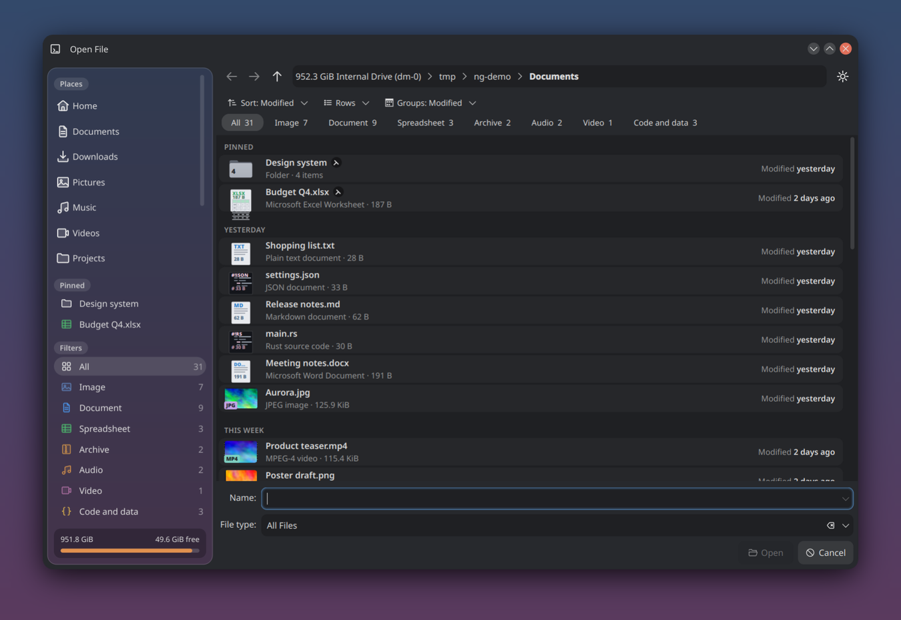
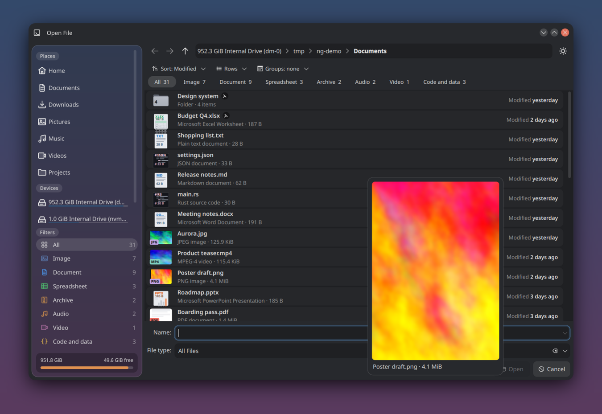

# Dialog NG

KDE's file dialog — the one every KDE app opens to pick or save a file, and that Firefox, Chrome and
Flatpak apps get through the desktop portal — with:

It looks and works like [Dolphin NG](https://github.com/Morzilla/dolphin-ng):

- **rows**: every file with Dolphin NG's drawing of its kind (a page, a sheet, lines of code, a waveform, a
  box, a folder with how many items it holds) or its own preview, its name, type and size, and how long ago it
  changed; two lines or compact, and **Ctrl + wheel** makes them larger or smaller. KDE's columns and icons are
  still in the View menu;
- **a quick preview**: rest the pointer on a file and a large picture of it shows beside the list (at once,
  or after the delay you choose; small, medium or large);
- **one bar**: sort (by name, size, type, date modified or **date created**), view, filters, groups, with the
  choice written on each button, and the path as breadcrumbs;
- **quick filters by kind of file**, with how many there are: chips in the bar when there is room, on a row of
  their own when not, a menu when the window is narrow;
- **groups**: titles between the rows, following the sort order (Today, Yesterday, This week…);
- **pinned items**: what is pinned in Dolphin NG comes first in its folder, and has its own section in the
  sidebar;
- **a glass sidebar**: the places on a card that shows the desktop blurred behind it (with a compositor that
  blurs; a tinted panel otherwise), titles as pills, the filters with their counts, the disk's usage at the
  foot.

The settings are shared by every application (`~/.config/dialog-ngrc`); Dolphin NG's settings page has the
quick preview's too (NG → Previews → Open/Save window). `Glass=false` in its `[Sidebar]` group turns the glass
off.

The labels come from KDE's own translations (KFileMetaData's file categories, KIO's "All Files"), so they
follow the language of the desktop.

Part of the NG desktop, with [Dolphin NG](https://github.com/Morzilla/dolphin-ng),
[Breeze NG](https://github.com/Morzilla/breeze-ng) and [NeoLine](https://github.com/Morzilla/neoline-icons).
The Breeze NG installer can install it too (part `dialog`).

## How it works

Only one library is replaced, `libKF6KIOFileWidgets`. `dialog-ng build` downloads KIO from invent.kde.org
**at the version installed on your system**, applies `dialog-ng.patch`, builds that library alone and puts it
in `~/.local/dialog-ng`. `dialog-ng on` makes the session load it (through `LD_LIBRARY_PATH`, from a
`~/.config/plasma-workspace/env` file) **only while its version matches the system's**: after an update of
KDE Frameworks the stock dialog comes back by itself until you run `dialog-ng build` again.
Nothing outside your home folder is touched.

## Install

    git clone https://github.com/Morzilla/dialog-ng.git
    cd dialog-ng
    ./dialog-ng deps     # KIO's build dependencies (sudo; dnf, apt or pacman)
    ./dialog-ng build    # a few minutes
    ./dialog-ng on       # then log out and in

Try it first in a single app: `./dialog-ng run kwrite`. Back to the stock dialog: `./dialog-ng off`
(from the next login). `./dialog-ng status` shows the built and the system versions.

## Licence

`dialog-ng.patch` changes KIO and is under KIO's licence, LGPL-2.0-or-later (the drawings of the kinds of file
come from Dolphin NG, by the same author, and are offered here under the same licence as the rest of the patch). The `dialog-ng` script is MIT.
Made by Morzilla with Claude (Anthropic), on top of KDE software.
